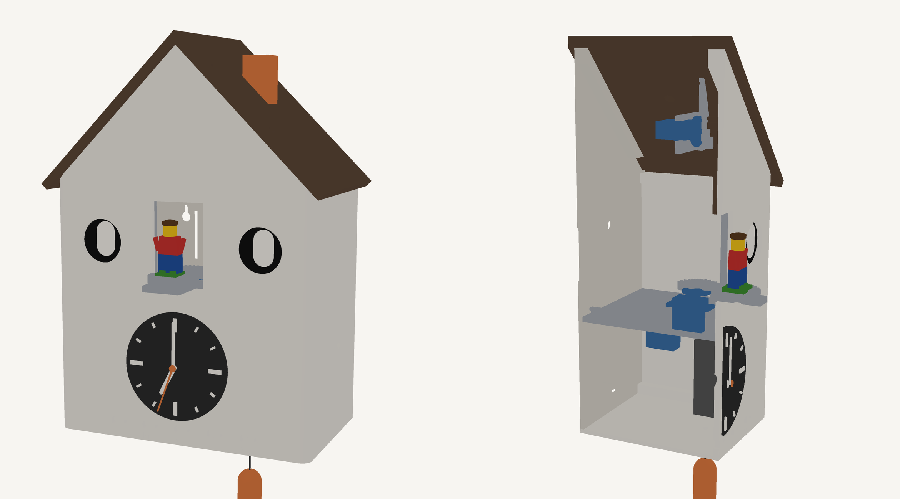

# Cuckoo clock

Horloge-réveil coucou imprimée en 3D, pilotée par un ESP32-S3, avec une figurine LEGO interchangeable qui sort par la porte.

## Fonctionnalités
- **Réveil** : heure réglée par une page web, jours armés par 5 interrupteurs (L à V), jamais le week-end. Lever de soleil progressif, puis la porte s'ouvre, la figurine sort et tourne, avec son et animation des yeux.
- **Coucou horaire**, coupé la nuit (20 h – 7 h).
- **Commandes** : encodeur rotatif pour le volume (appui = snooze, appui long = réglages), cheminée-bouton et contrepoids (tirette) pour déclencher le coucou.
- **Figurine LEGO** interchangeable sur une vraie plaque 2×2.
- **2 écrans ronds** en guise d'yeux, qui s'allument quand quelqu'un passe devant (radar de présence caché derrière la façade).

## Arborescence
| Dossier | Contenu |
|---|---|
| `hardware/` | modèle OpenSCAD paramétrique `coucou.scad`, STL prêts à imprimer, [README boîtier & mécanique](hardware/README.md) |
| `docs/` | rendus, face avant, [plan 1:1 à imprimer](docs/plan_face_avant_1-1.pdf) |
| `firmware/` | à venir |

Régénérer une pièce : `openscad -D 'part="body"' -o body.stl hardware/coucou.scad`

## Matériel (~65 €, prix AliExpress indicatifs)
| Qté | Composant | Rôle |
|---|---|---|
| 1 | ESP32-S3-DevKitC-1 **N16R8** | cerveau (PSRAM pour les écrans) |
| 2 | GC9A01 1,28" 240×240 | yeux |
| 3 | Servo MG90S (pignons métal) | porte, chariot, rotation |
| 1 | DFPlayer Mini + microSD | audio |
| 1 | Haut-parleur Ø40 mm 3 W 4 Ω | audio |
| 1 | Radar mmWave **LD2410C** | présence |
| 1 | DS3231 | heure sans Wi-Fi |
| 1 | MCP23017 | interrupteurs et boutons |
| 1 | KY-040 | volume, snooze |
| 5 | Interrupteurs MTS-102 | jours L-V |
| 5 | LED 3 mm (ou WS2812) | LED du jour |
| 1 | Bouton tactile 12×12 | cheminée |
| 1 | Micro-switch | contrepoids |
| 1 | Mouvement quartz **à axe long** | aiguilles |
| 1 | Alim 5 V 3 A + embase USB-C | alimentation |
| — | Condensateurs 1000 µF + 100 nF, résistance 1 kΩ | découplage servos, RX du DFPlayer |
| — | Plaques LEGO 2×2 | socles des figurines |
| — | ~30 inserts laiton M3, vis M2/M3 | assemblage |

## Brochage ESP32-S3
| Fonction | GPIO |
|---|---|
| SPI écrans SCK / MOSI / DC / RST | 12 / 11 / 9 / 10 |
| CS œil gauche / œil droit | 13 / 14 |
| Rétroéclairage (PWM) | 21 |
| I²C SDA / SCL (MCP23017, DS3231) | 8 / 18 |
| Interruption MCP23017 | 7 |
| DFPlayer TX / RX / BUSY | 17 / 16 / 15 |
| Servos porte / chariot / rotation | 4 / 5 / 6 |
| Encodeur A / B / SW | 1 / 2 / 42 |
| WS2812 / LED | 38 |
| LD2410C TX / RX / OUT | 39 / 40 / 41 |

MCP23017 : jours L-V sur GPA0-GPA4, contrepoids GPA5, cheminée GPA6.
Servos alimentés directement en 5 V avec 1000 µF au plus près.
