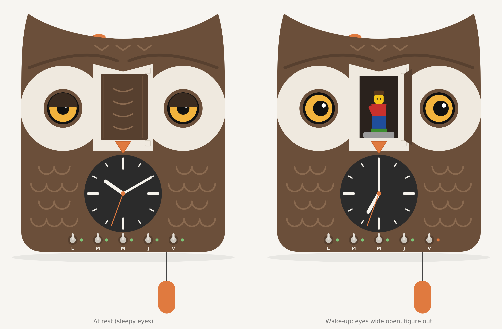
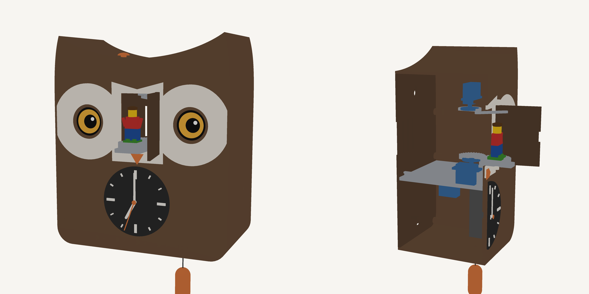

# Cuckoo clock

A 3D-printed owl-head cuckoo alarm clock driven by an ESP32-S3, with a swappable LEGO minifigure that comes out of the door.

## Features
- **Alarm**: wake-up time set from a web page, days armed with 5 toggle switches (Mon–Fri), never on weekends. Progressive sunrise, then the door opens, the figure comes out and turns, with sound and eye animation.
- **ESP32-driven hands**: NTP time, automatic DST changes, catch-up after a power cut, hand animations possible.
- **Hourly cuckoo**, muted at night (8 pm – 7 am).
- **Controls**: rotary encoder for volume (press = snooze, long press = settings), top button and pull-weight to trigger the cuckoo.
- **LEGO minifigure** swappable on a real 2×2 plate.
- **2 round displays** as the owl's eyes: sleepy at rest, wide open on wake-up, and waking up when someone walks by (presence radar hidden behind the front face).

## Repository layout
| Folder | Content |
|---|---|
| `hardware/` | parametric OpenSCAD model `coucou.scad`, print-ready STLs, [enclosure & mechanism README](hardware/README.md) |
| `docs/` | renders, front view, [1:1 printable front template](docs/front_template_1-1.pdf) |
| `tools/` | collision check, front view / 1:1 template / 3D render generators |
| `firmware/` | coming next |

Regenerate a part: `openscad -D 'part="body"' -o body.stl hardware/coucou.scad`

## Bill of materials (~65 €, indicative AliExpress prices)
| Qty | Part | Role |
|---|---|---|
| 1 | ESP32-S3-DevKitC-1 **N16R8** | brain (PSRAM for the displays) |
| 2 | GC9A01 1.28" 240×240 | eyes |
| 3 | MG90S servo (metal gears) | door, carriage, rotation |
| 1 | DFPlayer Mini + microSD | audio |
| 1 | Ø40 mm 3 W 4 Ω speaker | audio |
| 1 | **LD2410C** mmWave radar | presence |
| 1 | DS3231 | time without Wi-Fi |
| 1 | MCP23017 | switches and buttons |
| 1 | KY-040 | volume, snooze |
| 5 | MTS-102 toggle switches | Mon–Fri |
| 5 | 3 mm LEDs (or WS2812) | day LEDs |
| 1 | 12×12 tactile button | top button |
| 1 | Micro-switch | pull-weight |
| 1 | **Stepping (ticking)** quartz movement, long shaft, modified | hands |
| 1 | DRV5032 Hall sensor (SOT-23) + Ø3×2 neodymium magnet | minute-hand home mark |
| 2 | 150 Ω resistors (+ 2 × 1N4148, optional) | coil drive |
| 1 | 5 V 3 A PSU + USB-C socket | power |
| — | 1000 µF + 100 nF capacitors, 1 kΩ resistor | servo decoupling, DFPlayer RX |
| — | LEGO 2×2 plates | minifigure bases |
| — | 12 M3 brass inserts, M2/M3 screws, Ø2 × 80 mm brass rod | assembly, door hinge |

## ESP32-S3 pinout
| Function | GPIO |
|---|---|
| Display SPI SCK / MOSI / DC / RST | 12 / 11 / 9 / 10 |
| CS left eye / right eye | 13 / 14 |
| Backlight (PWM) | 21 |
| I²C SDA / SCL (MCP23017, DS3231) | 8 / 18 |
| MCP23017 interrupt | 7 |
| DFPlayer TX / RX / BUSY | 17 / 16 / 15 |
| Servos door / carriage / rotation | 4 / 5 / 6 |
| Encoder A / B / SW | 1 / 2 / 42 |
| WS2812 / LEDs | 38 |
| LD2410C TX / RX / OUT | 39 / 40 / 41 |
| Movement coil A / B | 47 / 48 |

MCP23017: Mon–Fri switches on GPA0–GPA4, pull-weight GPA5, top button GPA6, Hall sensor GPA7.
Servos powered straight from 5 V with 1000 µF close by.

## Timekeeping
The quartz movement has no battery or oscillator any more: the ESP32 drives its coil directly.
- **Movement mod**: open it, cut the 2 traces between the coil and the chip, solder 2 wires to the coil → GPIO 47 and 48, each through 150 Ω.
- **Stepping**: one ~30 ms pulse per second, alternating polarity (47 high / 48 low, then the reverse). Fast-forward possible at ~8 steps/s.
- **Homing**: a magnet glued under the minute hand, 28 mm from the shaft, passes the Hall sensor sitting in the back of the dial at 12 o'clock → the ESP32 re-syncs the minutes once an hour; the hour position is stored in flash.
- **DST / power cut**: fast-forward (spring, catch-up, ≤ 90 min for 12 h) or pause for one hour (autumn). The DS3231 keeps time without network.
- **First setup**: on the web page, enter once the time currently shown by the hands.
